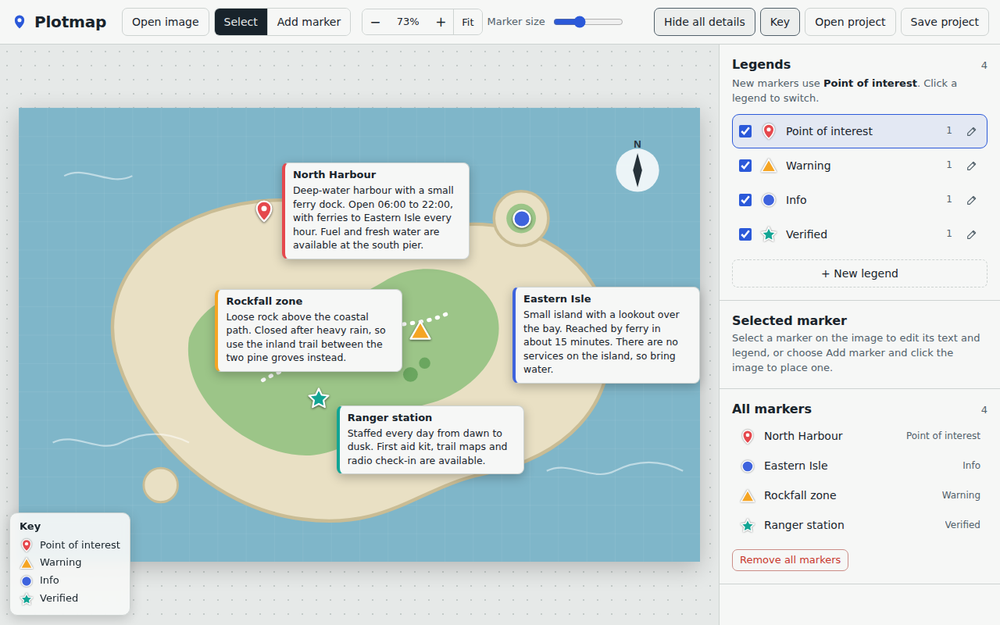

# Plotmap

Turn any image into an interactive map. Place markers, write hover info with expandable details, and organize everything with custom legends (your own symbols and colors).

Plotmap is a single HTML file. There is no build step, no dependencies and no server, and it works offline.



**Live demo:** https://codeblo.github.io/plotmap/

## Features

- **Use your own image.** Open a PNG, JPG, WebP, GIF or SVG file, drag it onto the page, or paste it. Use "Try a sample map" to see it working straight away.
- **Markers with info.** Give each marker a title and an info text. Hovering shows a card with the first two lines, and **Show details** expands it to the full text.
- **Show all details.** One button in the top bar puts the full text of every marker on the image at once. The cards are laid out so they avoid overlapping each other and the other markers.
- **Custom legends.** Create legends with a name, one of 8 symbols (circle, square, triangle, diamond, star, hexagon, cross, pin) and any color. Assign a legend to each marker, edit or delete legends, and show or hide a legend with its checkbox.
- **Key on the image.** A key lists the visible legends. Turn it on or off with the **Key** button.
- **Zoom and pan.** Zoom with the mouse wheel, drag the image to pan, and change the marker size with the slider.
- **Save your work.** Projects autosave in your browser. **Save project** downloads a file that includes the image, and **Open project** loads it again.

## Quick start

1. Open `index.html` in a recent version of Chrome, Edge, Firefox or Safari.
2. Choose **Open image** (or try the sample map).
3. Switch to **Add marker** and click the image to place markers.
4. Select a marker to give it a title, an info text and a legend.
5. Press **Show all details** to see everything at once.

## Controls

| To do this | Do this |
| --- | --- |
| Place a marker | Switch to **Add marker**, then click the image |
| Select a marker | Click it, or pick it from the **All markers** list |
| Move a marker | Drag it, or focus it and use the arrow keys (hold Shift for bigger steps) |
| Delete a marker | **Delete marker**, or the Delete key. You can undo it right after |
| Stop adding or deselect | Esc |
| Zoom | Mouse wheel (zooms at the cursor), the **+** and **−** buttons, or **Fit** to reset |
| Pan | Drag the image |
| Scroll sideways | Hold Shift and use the mouse wheel |
| Open a marker's card on a touch screen | Tap the marker |
| Choose the legend for new markers | Click a legend in the **Legends** panel |

## Info text and details

Each marker has one title and one info text.

- Hover a marker to see its title, its legend and the first two lines of its text.
- Press **Show details** on the card to see the full text and the marker's position in the image.
- Click or tap a marker to keep its card open.
- Use **Show all details** in the top bar to show the full text of every visible marker on the image. Hover cards are switched off while it is on.

## Legends

A legend is a name, a symbol and a color. The Legends panel starts with four examples (Point of interest, Warning, Info, Verified) that you can edit or delete.

- **New legend** opens a form for the name, symbol and color. You can also create one from the marker editor and assign it to the selected marker straight away.
- The pencil icon edits a legend. Deleting a legend moves its markers to another legend.
- The checkbox next to a legend hides or shows its markers on the image.

## Saving your work

- **Autosave:** your markers and legends are stored in your browser's local storage, for this browser and this web address only. Very large images may be too big to autosave.
- **Save project** downloads a `.plotmap.json` file that contains the image, markers and legends. Use it for backups or to move a project to another computer.
- **Open project** loads a saved file. Files from earlier versions also open, and markers that had separate hover text and details are merged into one text.

## Privacy

Everything happens in your browser. Your images and projects are not uploaded anywhere, and the page makes no network requests.

## Run it locally

Open `index.html` in your browser. No server is needed. If you prefer to serve it, any static file server works, for example:

```
python3 -m http.server 8000
```

Then open http://localhost:8000.

## Deploy with GitHub Pages

1. Put `index.html` at the root of your repository's main branch.
2. In the repository, go to **Settings → Pages**.
3. Under **Build and deployment**, set **Source** to **Deploy from a branch**.
4. Choose your branch and the `/ (root)` folder, then save.
5. After a minute or two the site is available at `https://YOUR-USERNAME.github.io/YOUR-REPO/`.

Replace the live demo link at the top of this file with your own address.

## Browser support

Recent versions of Chrome, Edge, Firefox and Safari.

## Limitations

- Markers are placed on the image itself. Plotmap does not use real-world coordinates such as GPS.
- A project holds one image.
- Autosave uses your browser's local storage, which has a size limit. Use **Save project** for large images.
